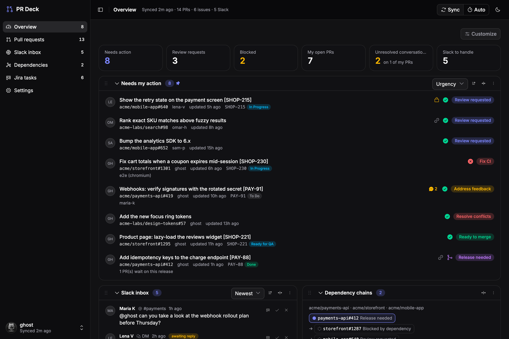

# PR Deck

A local dashboard for the pull requests you care about across several GitHub orgs, with the things
around them: cross-repo dependencies, Jira status, and a Slack inbox. It also runs an MCP server, so
Claude Code can query and edit the same data.

It runs on your machine only. The API binds to `127.0.0.1`, tokens stay in a local SQLite file, and
nothing is hosted.



## Features

- **Overview**: what needs your action (reviews, failing CI, feedback, conflicts, merges, releases),
  what's blocked, what you're waiting on. Customisable panels and clickable stat tiles.
- **Pull requests**: list or board, grouped by status, repo or org; search, filters, sort. A detail
  panel with checks, reviews, unresolved review conversations (linked to each comment), Jira issues,
  dependencies and a private note.
- **Dependencies**: "merge before" and "release before" links between PRs in different repos, from
  the PR description (`Depends on: owner/repo#12`, `Requires release of owner/repo#34`), Jira "is
  blocked by" links, or added by hand. An interactive graph shows the chains and the next step.
- **Releases**: what each release PR (dev → master, `release/*` → master) and each tag ships,
  merged work not in a release yet, hotfixes and whether they're back in dev, release trains across
  repos with a suggested shipping order, and a release graph per repo.
- **Feature flags**: flags a PR names in its description (`Feature flag: my-flag`) with their
  LaunchDarkly state per environment (read only).
- **Jira**: your issues and the issues referenced by PRs, with their linked PRs and status
  transitions.
- **Slack inbox**: mentions, unanswered DMs and group DMs, saved messages, and messages you reacted to
  with a "todo" emoji, shown in context and formatted.
- **Write Jira issues with Claude**: create and edit issues in a composer with every field your project
  has (required ones, sprint, story points, epics). Claude drafts or reworks the issue from your request,
  a PR, a Slack thread, screenshots, the repo's CLAUDE.md and a per-project writing guide; edits are
  reviewed as a diff before saving. From Slack it can reply in the thread with the link.
- **Prompts for AI agents**: copy a ready-to-paste brief for any Jira issue, with links to the issue,
  its parent and related issues, PRs, repos, feature flags, Slack threads and comments, plus how to work.
- **MCP server** for Claude Code with tools: `overview`, `list_prs`, `get_pr`, `jira_issue`,
  `add_dependency`, `remove_dependency`, `sync`, `slack_inbox`, `slack_thread`, `set_slack_status`,
  `jira_prompt`, `jira_fields`, `create_jira_issue`, `update_jira_issue`.
- Light, dark and system themes; keyboard navigation (arrow keys, Escape, shortcuts in the Slack
  panel).

## Requirements

- Node.js 24 (see `.nvmrc`)
- A GitHub account: the [GitHub CLI](https://cli.github.com/) login, or a personal access token
  with `repo` and `read:org`
- Optional: Jira Cloud, Slack, and Claude (Claude Code or an Anthropic API key)

## Getting started

```bash
git clone https://github.com/borovez/prdeck.git
cd prdeck
npm install
npm run dev
```

Open <http://localhost:5317> and go to **Settings**:

1. **GitHub**: click **Use my gh CLI login**, or add a token. Optionally limit each account to some
   orgs, and add **tracked repos** to pull in every open PR in those repos (team view).
2. **Jira** (optional): site URL, email and an
   [API token](https://id.atlassian.com/manage-profile/security/api-tokens).
3. **Slack** (optional): create a Slack app, add these **User Token Scopes**, install it to your
   workspace and paste the `xoxp-…` user token:
   `search:read, im:history, mpim:history, im:read, mpim:read, channels:history, groups:history, users:read, channels:read, groups:read, stars:read, reactions:read, reactions:write, chat:write`
4. **LaunchDarkly** (optional, read only): an access token with the Reader role
   ([Organization settings → Authorization](https://app.launchdarkly.com/settings/authorization)),
   the project key and the environments to show.
5. **Claude** (optional, for writing Jira issues): use your local
   [Claude Code](https://claude.com/claude-code) login (no API key needed), or an Anthropic API key.

Then press **Sync**. With **Auto** on, the server syncs in the background (every 5 minutes by
default).

## Download the Mac app

Download `PR-Deck-<version>-arm64.dmg` (Apple Silicon) or `-x64.dmg` (Intel) from
[Releases](https://github.com/borovez/prdeck/releases), open it and drag **PR Deck** to Applications.
It includes everything (no Node, git or npm needed) and keeps its data in `~/.prdeck`.

The app isn't signed with an Apple Developer ID yet, so the first time macOS says it can't check it:
right-click PR Deck in Applications → **Open** → **Open** (or System Settings → Privacy & Security →
**Open Anyway**). After that it opens normally.

Updates: the app checks GitHub for new releases and offers the new `.dmg` (menu **PR Deck → Check for
Updates…**, and **Update available** in the header). Download it and drag it to Applications,
replacing the old one; your data stays.

If the background server from `npm run app:install` is running, the app uses it instead of starting
its own.

## Install as a Mac app

PR Deck is a Progressive Web App: install it from the browser and it gets a Dock icon, its own
window and Launchpad/Spotlight entries. The installed app talks to the local server, so first make
the server run in the background:

```bash
npm run app:install
```

This builds the web app and registers a macOS LaunchAgent (`prdeck.server`) that starts the server
at login and restarts it if it stops. It serves the app at <http://127.0.0.1:4317>. Logs go to
`~/Library/Logs/PRDeck.log` (`npm run app:logs`).

Then install the app from that address:

- **Chrome, Edge, Arc**: the install icon at the right of the address bar, or the menu → *Cast, save
  and share* → *Install page as app*.
- **Safari**: *File* → *Add to Dock*.

In Chrome and Edge the app draws its own title bar ("window controls overlay"): the browser's bar
with its menu, extensions and uninstall buttons is replaced by PR Deck's header, and the header
drags the window. A small toggle in the top corner brings the browser's bar back. Safari web apps
always get a plain macOS title bar.

Updating: the app checks this repo's GitHub releases every few hours and shows **Update available**
in the header, with the release notes and **Update and restart** (it pulls, installs, rebuilds and
restarts the background server, then reloads). By hand: `npm run app:update`. The user menu shows the
version and **Check for updates**.

### On an Android phone (USB-C)

With the phone connected by cable and USB debugging on (Settings → About phone → Software information
→ tap Build number 7 times; then Developer options → USB debugging), run `npm run phone` (needs
`brew install android-platform-tools`). It forwards the phone's `localhost:4317` to your Mac and opens
PR Deck in Chrome; Chrome menu → Add to home screen → Install. It works while the cable is connected
(run it again after reconnecting); the server and your tokens stay on the Mac.

Removing: `npm run app:uninstall` stops the server and removes it from login. Remove the app itself
like any other app (in Chrome, its window menu → *Uninstall*; for Safari web apps, drag it out of
`~/Applications`). Your data in `~/.prdeck` stays.

The background server and `npm run dev` both use port 4317 by default, so stop one before starting
the other (`npm run app:uninstall`, or give the service another port with
`PRDECK_PORT=4320 npm run app:install`).

### Use from Claude Code

Settings → MCP shows the exact `claude mcp add` command for your machine. It runs `npm run mcp`
(a stdio MCP server) against the same database.

## Scripts

| Command | What it does |
| --- | --- |
| `npm run dev` | API on `127.0.0.1:4317` and the web app on `localhost:5317`, both reloading on change |
| `npm run build` | Build the web app into `web/dist` |
| `npm start` | Run the API, which also serves the built app |
| `npm run mcp` | Run the MCP server (stdio) |
| `npm run typecheck` | Typecheck the server and the web app |
| `npm run app:install` | Build and run the server in the background at login (macOS), for the installed app |
| `npm run app:uninstall` | Stop the background server and remove it from login |
| `npm run app:logs` | Follow the background server's log |
| `npm run app:update` | Pull the latest version, rebuild and restart (what **Update and restart** runs) |
| `npm run phone` | Open PR Deck on an Android phone connected by USB (adb reverse) |
| `npm run release -- patch\|minor\|major` | Bump the version, tag, push, create a GitHub Release and attach the Mac app (installed apps offer the update) |
| `npm run desktop` | Run the Mac app from source |
| `npm run desktop:dist` | Build the Mac app (`desktop/dist/*.dmg`, unsigned) |

## Configuration

| Variable | Default | Purpose |
| --- | --- | --- |
| `PRDECK_DATA_DIR` | `~/.prdeck` | Where the SQLite database lives (settings, tokens, cache) |
| `PRDECK_PORT` | `4317` | API port |
| `CLAUDE_BIN` | found on `PATH` | Path to the `claude` CLI, if it isn't found |
| `ANTHROPIC_API_KEY` | | Used for drafting when no key is stored in Settings |

## Security

- The API only listens on loopback (`127.0.0.1`) and never returns stored tokens to the browser.
- Tokens are stored unencrypted in the local database under `PRDECK_DATA_DIR`. Protect that folder
  like any other credentials file.
- Drafting through Claude Code runs `claude -p` in safe mode with no tools and no saved session.

## Stack

- **Server**: Node.js, TypeScript, Hono, `node:sqlite`, GitHub GraphQL, Jira REST v3, Slack Web API,
  `@anthropic-ai/sdk`, `@modelcontextprotocol/sdk`
- **Web**: Vue 3, Pinia, vue-router, Tailwind CSS v4, shadcn-vue (reka-ui), Phosphor icons,
  Vue Flow + dagre for the dependency graph, vue-sonner

## License

[MIT](LICENSE)
